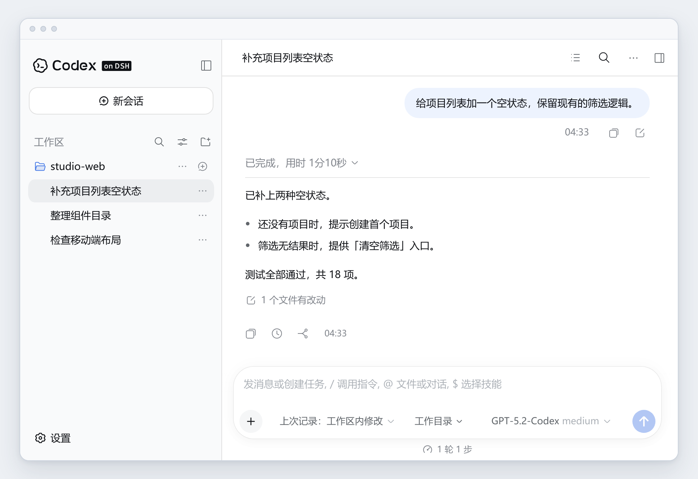

<h1></h1>

> **纯粹的 Codex 展示层。会话数据只来自本机 Codex。**

在独立的 DeepSeek Harness `codex` Profile 中浏览 Codex 项目和会话、查看历史，或接着处理 CLI 中的任务。

界面示意，使用模拟会话。

## 核心功能

- 浏览项目、会话、归档和子智能体，搜索历史并实时查看消息与工具记录。
- 在原会话发送消息、转发审批与问答、查看和管理队列与后台任务。
- 使用 DSH 原生界面预览工作区文件、查看差异、粘贴图片和引用路径。
- 在网页选择 Codex 技能、管理插件与 MCP、选择 Git 工作树，并导出完整会话 Markdown。

## 运行边界

Codex 持有项目、会话历史、模型、权限和执行状态。网页通过本机共享 Codex App Server 读取这些状态并提交操作。本地存储用于界面设置、草稿、列表缓存和用户上传的附件。

运行时需要既有的 Codex 登录与共享服务，网页默认只监听本机回环地址。

## 已验证版本

- **Codex App Server** `0.171.0`
- **DeepSeek Harness（DSH）** `0.2.3-alpha.2`

[安装与使用](manual/guide.md) · [给 AI 助手的安装指南](manual/ai-install.md) · [架构](https://github.com/lingsamuel/dsh-codex/blob/master/docs/architecture.md)
